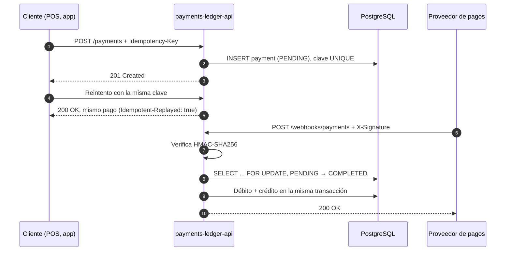

# payments-ledger-api

API REST de pagos con **ledger de doble entrada**, **claves de idempotencia** y **webhooks firmados**. Hecha en Java 21 y Spring Boot 3.

[](https://github.com/dechouriog/payments-ledger-api/actions/workflows/ci.yml)


> Versión demo. El objetivo es mostrar cómo se resuelven los problemas centrales de un sistema de pagos: cobros duplicados, confirmaciones que llegan dos veces y saldos que siempre cuadran.

## Qué hace

- **Idempotencia:** cada pago lleva un header `Idempotency-Key`. Si el cliente reintenta por un timeout, recibe el mismo pago y no se cobra dos veces. Si reutiliza la clave con otros datos, recibe `409`.
- **Ledger de doble entrada:** cada pago completado genera un débito al pagador y un crédito al beneficiario por el mismo monto. La suma de todo el ledger siempre es cero.
- **Webhooks firmados:** el proveedor de pagos confirma o rechaza cada pago con un webhook firmado con HMAC-SHA256. Un webhook repetido no duplica asientos.
- **Saldos calculados:** el saldo de una cuenta no se guarda; se calcula sumando sus asientos.
- **Seguridad:** los endpoints de cuentas y pagos exigen un JWT.

## Flujo de un pago



## Endpoints

| Método | Ruta | Auth | Descripción |
|---|---|---|---|
| POST | `/auth/token` | — | Token de prueba (solo en desarrollo) |
| POST | `/accounts` | JWT | Crea una cuenta |
| GET | `/accounts/{id}/balance` | JWT | Saldo calculado desde el ledger |
| POST | `/payments` | JWT | Crea un pago (requiere `Idempotency-Key`) |
| GET | `/payments/{id}` | JWT | Consulta un pago y su estado |
| POST | `/webhooks/payments` | HMAC | El proveedor informa `COMPLETED` o `FAILED` |

Documentación interactiva en Swagger UI: `http://localhost:8080/swagger-ui.html`.

Los montos van en **unidades mínimas** (`amountMinor`): 2500000 son $25.000,00 COP.

## Cómo correrlo

Solo necesitas **Docker**:

```bash
git clone https://github.com/dechouriog/payments-ledger-api.git
cd payments-ledger-api
docker compose up --build
```

Con la API arriba, en otra terminal (en Windows, usa Git Bash):

```bash
./scripts/demo.sh
```

El script recorre todo el flujo: pide un token, crea dos cuentas, hace un pago, lo reintenta con la misma clave, envía el webhook firmado y muestra los saldos.

## Decisiones de diseño

- **Dinero en enteros (`long`)**, nunca en `double`: `0.1 + 0.2` no da `0.3` en punto flotante.
- **Idempotencia respaldada por la base de datos.** La clave tiene una restricción `UNIQUE`. Si llegan dos solicitudes iguales al mismo tiempo, una gana y la otra recibe el pago ganador.
- **Bloqueo pesimista en el webhook** (`SELECT ... FOR UPDATE`) para que dos confirmaciones simultáneas del mismo pago se procesen una tras otra.
- **El cambio de estado y los asientos se guardan en la misma transacción.** O se guarda todo o no se guarda nada.
- **Ledger inmutable.** Los asientos no tienen setters, y una restricción `UNIQUE (payment_id, direction)` impide asientos duplicados aunque falle la lógica de la aplicación.
- **Máquina de estados explícita.** Solo `PENDING` puede pasar a `COMPLETED` o `FAILED`.
- **La firma se verifica sobre el cuerpo exacto** antes de interpretarlo, y la comparación es en tiempo constante.
- **Errores en formato estándar** RFC 9457 (Problem Details) con un `code` estable, por ejemplo `IDEMPOTENCY_KEY_REUSED`.

## Stack

Java 21 · Spring Boot 3.3 · Spring Web · Spring Data JPA · Spring Security (OAuth2 Resource Server, JWT) · PostgreSQL 16 · Flyway · springdoc-openapi · JUnit 5 · Testcontainers · Docker · GitHub Actions

## Pruebas

```bash
mvn verify
```

Los tests de integración levantan un PostgreSQL real con Testcontainers (requieren Docker) y cubren el flujo completo: creación del pago, reintento idempotente, conflicto por clave reutilizada, webhook repetido, firma inválida, falta de token y saldos.

## Próximos pasos

- Validar saldo disponible antes de aprobar un pago.
- Reembolsos como asientos inversos.
- Patrón outbox para publicar eventos de pago.
- Conectar el webhook con Open Payments, como en el [POS móvil](https://github.com/dechouriog/pos-open-payments).

## Autor

**Diego Chourio Garcia** · Estudiante de Ingeniería de Sistemas, Universidad EAFIT · [LinkedIn](https://www.linkedin.com/in/diego-eduardo-chourio-garcia-472291385/)

Licencia [MIT](LICENSE).
